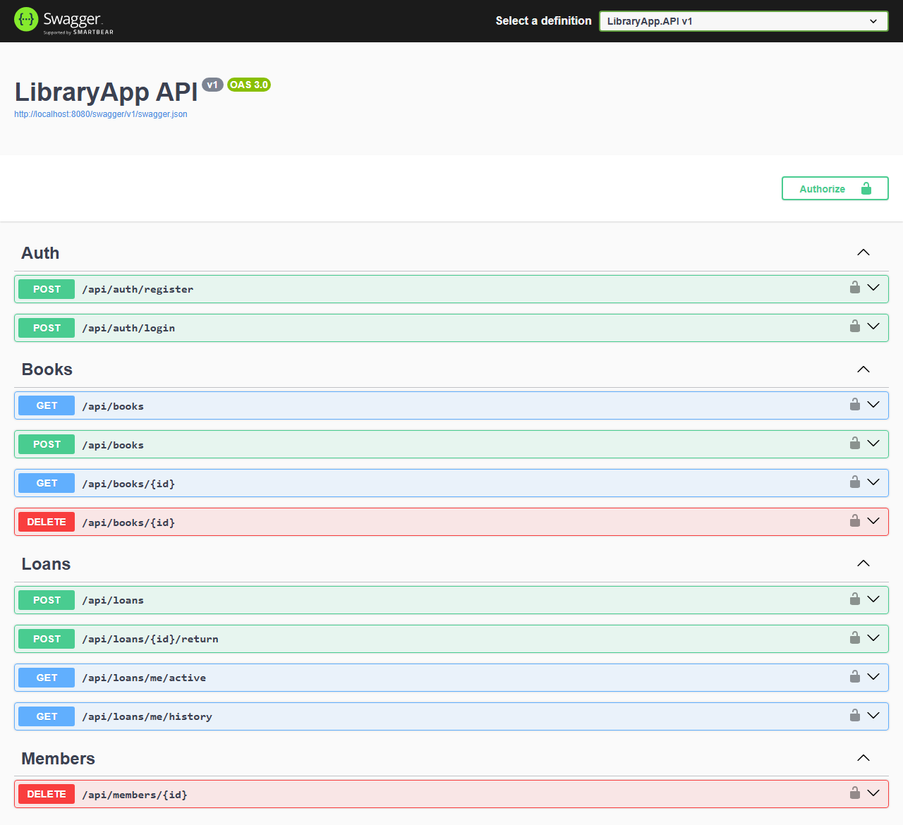

# LibraryApp

[](https://github.com/Emyazici/LibraryApp/actions/workflows/ci.yml)


A library management REST API built with **.NET 8**, following **Clean Architecture**, **Domain-Driven Design** and **CQRS**. Authentication is delegated to **Keycloak** (OpenID Connect), and the whole stack runs with one `docker compose up`.

**Highlights**

- **DDD:** `Book` and `Loan` aggregates guard their own invariants. Value objects (`ISBN`, `LoanPeriod`, `Money`) are immutable and validate themselves, and domain events are published after the transaction commits.
- **CQRS with MediatR:** every use case is a command or query handler, and a pipeline of behaviors (logging → validation → performance) wraps each one.
- **Authentication with Keycloak (OIDC):** the API never stores passwords. It validates Keycloak-issued JWTs and maps realm roles (`Admin`, `Employee`, `Customer`) onto ASP.NET Core role-based authorization.
- **Global error handling:** `IExceptionHandler` returns RFC 9457 `ProblemDetails` responses.
- **Persistence:** EF Core and PostgreSQL, with soft delete through global query filters and automatic migrations plus sample data in Development.
- **Testing and CI:** 102 unit tests and 10 integration tests (Testcontainers + `WebApplicationFactory`), run by GitHub Actions on every push.



---

## Getting Started

**Prerequisite:** Docker Desktop. Nothing else is needed.

```bash
git clone https://github.com/Emyazici/LibraryApp.git
cd LibraryApp
docker compose up --build
```

The first start takes about a minute while Keycloak boots and imports the realm. When it is ready:

| Service | URL |
| --- | --- |
| Swagger UI | http://localhost:8080/swagger |
| Health check | http://localhost:8080/health |
| Keycloak admin console | http://localhost:8180 (`admin` / `admin`) |

### Demo users (seeded into Keycloak)

| Username | Password | Role |
| --- | --- | --- |
| `admin@libraryapp.local` | `Admin123!` | Admin |
| `employee@libraryapp.local` | `Employee123!` | Employee |
| `customer@libraryapp.local` | `Customer123!` | Customer |

The database is seeded with 3 authors and 5 books. The demo customer already has a library membership.

### Try it in Swagger

1. Call `POST /api/auth/login` with one of the users above, for example `{ "username": "customer@libraryapp.local", "password": "Customer123!" }`.
2. Copy `accessToken` from the response, click **Authorize** and paste it.
3. Call `GET /api/books` to see the catalogue, then borrow a book with `POST /api/loans` (`{ "bookId": "...", "dueDate": "<a date within 60 days>" }`).
4. Check `GET /api/loans/me/active`, return the book with `POST /api/loans/{id}/return`, and see `GET /api/loans/me/history`.

To try the full sign-up flow, call `POST /api/auth/register`. It creates the user in Keycloak and the library membership in PostgreSQL, and you can log in with the new user straight away.

> All credentials in `docker-compose.yml` and `keycloak/realm-export.json` are **dev-only** values.

---

## Architecture

```
LibraryApp/
├── LibraryApp.Domain/             # Entities, aggregates, value objects, domain events, repository interfaces
├── LibraryApp.Application/        # CQRS commands/queries, validators, pipeline behaviors, abstractions
├── LibraryApp.Infrastructure/     # EF Core + PostgreSQL, repositories, Keycloak clients, seeding
├── LibraryApp.API/                # ASP.NET Core Web API: controllers, auth, ProblemDetails, Swagger
├── LibraryApp.Tests/              # Unit tests (Domain + Application)
├── LibraryApp.IntegrationTests/   # API tests with Testcontainers PostgreSQL
├── keycloak/realm-export.json     # Realm, client, roles and demo users (auto-imported)
└── docker-compose.yml             # PostgreSQL + Keycloak + API
```

Dependencies point inward:

```
API ──► Application ──► Domain
 │           ▲
 └──► Infrastructure
```

`Domain` has no external dependencies. `Application` only knows `Domain` and defines the interfaces it needs (`ICurrentUserService`, `IKeycloakAdminClient`, `IAuthTokenService`, repositories). `Infrastructure` implements them. Keycloak is invisible to the Domain: a member's link to their identity is a neutral `ExternalIdentityId`, and `Member.Id` equals the token's `sub` claim.

### Request flow

```
HTTP ─► Controller (thin) ─► ISender.Send(command)
          ─► LoggingBehavior ─► ValidationBehavior ─► PerformanceBehavior ─► Handler
               Handler ─► Aggregate methods (business rules) ─► Repository ─► UnitOfWork.SaveChanges
                                                                      └─► domain events published via MediatR
          ◄─ Result<T> ─► ResultExtensions ─► 200 / 204 / 400 ProblemDetails
```

### Key design decisions

| Decision | Why |
| --- | --- |
| Delegate auth to Keycloak instead of issuing our own JWTs | This is the pattern used in real enterprise systems. The API only validates tokens through OIDC discovery and never handles password hashing. |
| `Member.Id` = Keycloak `sub` | Handlers can use the authenticated user id directly as the member id, with no lookup table. |
| `Result<T>` for expected failures, exceptions for broken invariants | Business outcomes like "book not found" are not exceptional. Invariant violations inside aggregates throw `BusinessRuleException`. |
| Domain events dispatched after `SaveChanges` | Handlers never react to state that was not persisted. |
| Roles mapped with `IClaimsTransformation` | Keycloak nests roles under `realm_access.roles`. Flattening them into role claims keeps `[Authorize(Roles = ...)]` idiomatic. |

---

## API

| Method | Route | Description | Access |
| --- | --- | --- | --- |
| POST | `/api/auth/register` | Create Keycloak user + library member (role `Customer`) | Anonymous |
| POST | `/api/auth/login` | Exchange credentials for a Keycloak access token | Anonymous |
| GET | `/api/books` | List books | Authenticated |
| GET | `/api/books/{id}` | Book details | Authenticated |
| POST | `/api/books` | Add a book | Admin, Employee |
| DELETE | `/api/books/{id}` | Soft-delete a book | Admin |
| POST | `/api/loans` | Borrow a book as the current member | Customer |
| POST | `/api/loans/{id}/return` | Return own loan (late fee applied if overdue) | Customer |
| GET | `/api/loans/me/active` | Current member's active loans | Customer |
| GET | `/api/loans/me/history` | Current member's full loan history | Customer |
| DELETE | `/api/members/{id}` | Soft-delete a member | Admin |
| GET | `/health` | Liveness + database check | Anonymous |

### Error handling

Every error is returned as `application/problem+json`.

| Source | HTTP status |
| --- | --- |
| FluentValidation `ValidationException` | **400**, `ValidationProblemDetails` with field errors |
| Failed `Result` from a handler | **400**, `detail` carries the message |
| `BusinessRuleException` (domain invariant) | **422** |
| `NotFoundException` | **404** |
| Missing or invalid token | **401** |
| `UnauthorizedException` / insufficient role | **403** |
| Anything else | **500**, generic message, details only in logs |

---

## Domain

- **Book** (aggregate): `Borrow()` decrements stock and switches to `Loaned` when the last copy goes. `Return()` restores stock.
- **Loan** (aggregate): `Return()` closes the loan as `Returned`, or as `Overdue` with a late fee of 2 TRY per day.
- **Member** and **Author**: entities.
- **Value objects:** `ISBN` (ISBN-10/13, normalises hyphens and spaces), `LoanPeriod` (at most 60 days, `IsOverdue()`, `Extend()`), `Money` (non-negative, same-currency arithmetic).
- **Domain events:** `BookCreated`, `BookBorrowed`, `BookReturned`, `LoanBorrowed`, `LoanReturned`.

**Business rules**

- A member cannot borrow the same book twice at the same time.
- The maximum loan period is 60 days, and the due date must be in the future.
- A book with no stock cannot be borrowed.
- A loan cannot be returned twice, and only its owner can return it.

---

## Tech Stack

| Area | Technology |
| --- | --- |
| Runtime / Web | .NET 8, ASP.NET Core Web API, Swagger (Swashbuckle) |
| Application | MediatR (CQRS + pipeline behaviors), FluentValidation |
| Persistence | EF Core 8, PostgreSQL 16 (Npgsql) |
| Identity | Keycloak 26 (OIDC, JWT Bearer, Admin REST API) |
| Testing | xUnit, FluentAssertions, Moq, Testcontainers, `Microsoft.AspNetCore.Mvc.Testing` |
| DevOps | Docker (multi-stage build), Docker Compose, GitHub Actions |

---

## Tests

| Project | Tests | Scope |
| --- | --- | --- |
| `LibraryApp.Tests` | 102 | Domain aggregates and value objects; Application handlers with mocked ports |
| `LibraryApp.IntegrationTests` | 10 | Full HTTP pipeline against a real PostgreSQL container: auth, roles, validation, borrow/return flow |

```bash
dotnet test                                   # everything (integration tests need Docker running)
dotnet test LibraryApp.Tests                  # unit tests only
dotnet test LibraryApp.IntegrationTests       # integration tests only
```

The full list of tests is in [docs/TESTS.md](docs/TESTS.md).

---

## Running locally without Docker for the API

```bash
docker compose up postgres keycloak -d   # infrastructure only
dotnet run --project LibraryApp.API      # http://localhost:5072/swagger
```

In Development the API applies migrations and seeds sample data on startup. Its settings (`appsettings.Development.json`) point at Keycloak on `localhost:8180`.
